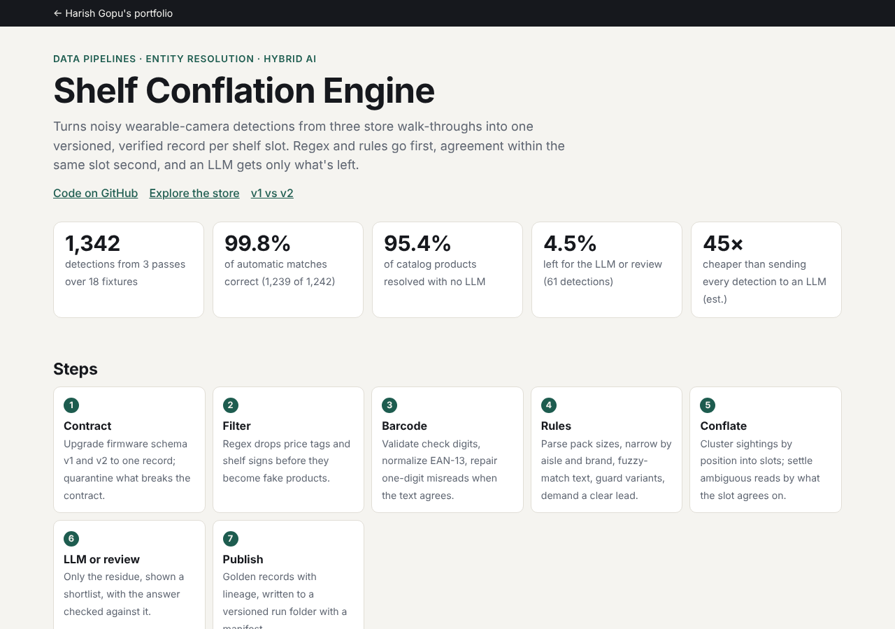

# Shelf Conflation Engine

A staged, versioned pipeline that turns noisy shelf detections from wearable cameras into **one verified "golden record" per shelf slot**, matched to a master product catalog. It uses **rules and regex where the problem is bounded, spatial agreement where context can settle it, and an LLM only for the small residue left over.**

**Live demo:** https://shelf-conflation-engine.vercel.app · part of [Harish Gopu's portfolio](https://harish04010-portfolio.vercel.app)



## The problem

Cameras walk the same aisles three times. Each pass produces detections with a position on the fixture, OCR'd label text and sometimes a barcode. The input is messy in all the ways real shelf data is:

- **Partial, noisy text:** "5UMMIT Fizz Cola ZRO 12oz", "Honey Crunch (340g)", "12 OZ HARVEST LANE". Brand or variant is often missing; OCR swaps O/0, l/1 and S/5.
- **Sizes written many ways:** 12oz, 355 mL, 2L, 67.6 FL OZ, (227g). And a bare "oz" can mean fluid ounces or weight.
- **Barcodes:** often missing, sometimes misread by one digit, sometimes sent as EAN-13 with a leading zero.
- **Noise:** duplicates, and price tags read as if they were products.
- **A schema change:** the edge firmware changed between passes 2 and 3 (renamed fields, centimeters instead of meters).
- **A changing shelf:** gaps appear, slots are reset to other products, and new items show up that aren't in the catalog.

## Results

1,342 detections from 3 passes over 18 fixtures (432 shelf slots, 179 catalog products), scored against the simulator's ground truth, which the pipeline never reads.

| | v1 (naive) | **v2 (current)** |
|---|---|---|
| Automatic matches correct | 72.4% (311 wrong) | **99.8% (3 wrong of 1,242)** |
| Catalog detections resolved with no LLM | 62.7% | **95.4%** |
| Left for the LLM or human review | – | **61 (4.5%)** |
| Fake slots created from price tags | 36 | **0** |
| Slot status correct (in stock / changed / gap / new) | 56.9% | **90.7%** |
| Slot product correct | 66.0% | **94.6%** |

Where v2 resolved each detection, and how often it was right:

| Tier | Detections | Correct |
|---|---|---|
| Filter: price tags and shelf signs (regex) | 37 | 37 |
| Barcode with a valid check digit | 551 | 551 |
| Barcode repair: one-digit misread, confirmed by text | 116 | 116 |
| Rules: size + brand + aisle blocking, fuzzy text, variant guard, margin | 253 | 252 |
| Slot agreement: same-slot consensus | 322 | 320 |
| LLM or review queue | 61 | not auto-resolved |

**Cost:** sending every detection to an LLM with a 20-product shortlist would take 1,342 calls (about $1.66). The tiered design needs 61 calls (about $0.04), roughly **45× cheaper**, and leaves 95% of decisions deterministic and repeatable. Both figures are estimates from prompt length at assumed rates of $3 and $15 per million input and output tokens; see [`llm.py`](shelf_engine/llm.py).

## How it works

```
raw detections (schema v1 + v2)
  └─ contracts.py   upgrade both schemas to one record; quarantine the 15 that break the contract
  └─ match.py       filter → barcode → barcode repair → rules            (per detection)
  └─ conflate.py    cluster sightings into slots (DBSCAN on position)    (per fixture)
                    → slot agreement settles ambiguous reads
  └─ llm.py         shortlist-only LLM call, answer checked against the shortlist; review queue without a key
  └─ conflate.py    golden record per slot: product, status, confidence, lineage
  └─ pipeline.py    out/<version>/run-<input hash>/  manifest, matches, golden records, quarantine
```

| Stage | Why this tool |
|---|---|
| **Regex** for price tags, sizes, OCR fixes and abbreviations | The patterns are bounded. Regex is exact, free and testable. |
| **Check digits** for barcodes | A misread almost always fails its check digit. A one-digit misread is repaired only when the label text points to the same product. |
| **Blocking** by aisle, brand and pack size | Shrinks the candidates from 179 to a handful before fuzzy matching, and stops a 12 oz match landing on the 20 oz product. |
| **Variant guard and margin rule** | A label that says "Zero Sugar" can't match the Original, and a match needs a 6-point lead over the runner-up, otherwise it's marked ambiguous instead of guessed. |
| **Spatial consensus** | If other sightings of the same slot resolved confidently, an ambiguous read that has that product on its shortlist takes it. This is free context, and it settles most of what would otherwise go to an LLM. |
| **LLM** for the residue | Only for genuinely ambiguous reads, given only a shortlist, with the answer rejected unless it's on that shortlist. |

**Versioning.** Each run writes to `out/<pipeline version>/run-<input hash>/` with a manifest (pipeline version and change list, schema versions seen, counts, cost). The same input always produces byte-identical output, which a test checks, so v1 and v2 can be diffed slot by slot. The site shows the slots where they disagree and which version was right.

## Things I caught and fixed

1. **Split slots.** At an 8 cm clustering radius, 8 slots were split in two because one sighting drifted. The fragment with no pass-3 sighting then showed up as a false "gap". 10 cm splits none and merges none; 12 cm started merging price tags into slots in v1.
2. **A shortlist that dropped the right answer.** "Honey Crunch 12 OZ" has no brand, so several products tied. Keeping a fixed top 5, ordered by GTIN on ties, cut out the correct one, so slot agreement couldn't rescue it. Keeping every near-tie (within 10 points, up to 12) cut the review queue from 92 to 61 and raised coverage from 93.0% to 95.4%, with precision unchanged.
3. **v1's naive choices, measured:** exact barcode lookup missed every EAN-13 read with a leading zero, and fuzzy matching with no margin or variant guard produced 311 wrong matches. Price tags became 36 fake shelf slots.

## Run it

```bash
pip install -r requirements.txt
python -m shelf_engine          # generate inputs, run v1 and v2, evaluate, write site/data.json
pytest -q                       # 9 tests
python -m http.server -d site   # view the page at http://localhost:8000
```

Set `ANTHROPIC_API_KEY` (and optionally `SHELF_MODEL`) to have the LLM tier make real calls instead of queuing for review.

## Limits

- **The data is simulated.** Brands are fictional; every GTIN has a valid check digit. Public product databases (such as Open Food Facts) weren't reachable from the build environment. Catalog records use the fields a real catalog has (GTIN, brand, line, variant, size), so a real catalog can be mapped in.
- **The LLM tier hasn't been run.** Without a key, the 61 ambiguous detections go to a review queue, and the cost figures are estimates.
- **A missed sighting looks like an empty shelf.** 16 of the 37 flagged gaps are in-stock slots the cameras missed on the last pass. Telling them apart needs another pass or a second signal.
- **New items without a barcode** mostly land in review instead of being recognized as new, because their text resembles existing products. That's the safe failure mode, but it isn't detection.

## Stack

Python 3.11+, [RapidFuzz](https://github.com/rapidfuzz/RapidFuzz) for fuzzy text matching, [scikit-learn](https://scikit-learn.org) DBSCAN for spatial clustering, pytest, GitHub Actions. The front end is a single static page with no framework.
